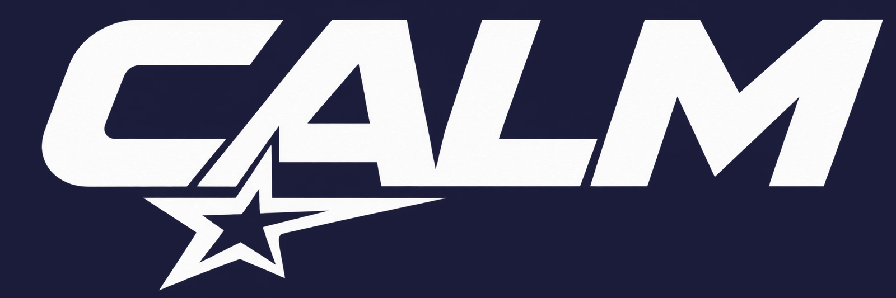

<div align="center">



# CALM — Roleplay Framework

**Un framework de rol independiente, modular y de código abierto.**

CALM es el nombre de trabajo elegido. El repositorio se llama `calm-rp-framework`; el nombre del proyecto no incluye ninguna marca de Rockstar, y la referencia a GTA aparece solo como tema descriptivo en los _topics_. No se afirma compatibilidad, autorización ni colaboración con Rockstar Games. La revisión de marcas sigue pendiente.

[](https://github.com/smouj/calm-rp-framework/actions/workflows/ci.yml)
[](./LICENSE)
[](./docs/roadmap/ROADMAP.md)
[](./CONTRIBUTING.es.md)
[](https://discord.com/invite/BVWXWY5eUT)
[](./docs/server/RUNTIME_REQUIREMENTS.md)

**[English](./README.md) · [Español](./README.es.md) · [Contribuir](./CONTRIBUTING.es.md) · [Código de conducta](./CODE_OF_CONDUCT.es.md) · [Soporte](./SUPPORT.es.md) · [Hoja de ruta](./docs/roadmap/ROADMAP.md) · [Metas](./GOALS.es.md) · [Discord comunitario](https://discord.com/invite/BVWXWY5eUT)**

</div>

> [!IMPORTANT]
> **Todavía no es jugable.** Este repositorio no ofrece ningún cliente o servidor multijugador de GTA VI, instalador ni modificación funcional. Es un proyecto independiente de aficionados que desarrolla sistemas de roleplay y se prepara para una posible integración **futura, legítima y autorizada**. No es un FiveM para GTA VI funcional ni un producto oficial de Rockstar.

## Funciones públicas y revisión legal (24 de noviembre de 2026)

El proyecto distingue las funciones oficiales **FiveM/Qbox** de las interfaces aún desconocidas de **GTA VI**. El núcleo de rol incorpora contratos originales y capacidades explícitas del adaptador; las capacidades reales de GTA VI siguen sin verificar.

- [Matriz de funciones, eventos y conceptos técnicos](./docs/research/FUNCTIONS_AND_INTERFACES_MATRIX_2026-11-24.md)
- [Análisis preliminar de interoperabilidad, licencias y propiedad intelectual](./docs/legal/INTEROPERABILITY_AND_IP_REVIEW_2026-11-24.md)
- [Base jurídica: artículos concretos que hacen legal este proyecto](./docs/legal/LEGAL_BASIS_ARTICLES_2026-11-24.md)
- [Verificación local: el gate autoritativo, sin depender del CI alojado](./docs/operations/LOCAL_VERIFICATION.md)
- [Referencias de investigación técnica de RAGE 9](./docs/research/GTA6_RESEARCH_2026-11-24.md)
- [Versiones comprobadas de herramientas de terceros](./docs/research/THIRD_PARTY_TOOLS_SNAPSHOT_2026-11-24.md)

**Importante:** estudiar documentación de ingeniería inversa no concede permiso para publicar archivos filtrados, reutilizar código protegido ni poner en marcha servidores GTA VI no autorizados. No hay integración jugable.

## Nuestro objetivo

Crear entre todos una **plataforma abierta de roleplay inspirada en las posibilidades de FiveM**, con GTA VI como aspiración a largo plazo.

Podemos construir ya lógica de personajes, economía, inventarios, propiedades, empleos, administración, simulación, herramientas y pruebas sin depender de archivos del juego. La integración real con GTA VI solo podrá abordarse si existe una vía técnica y jurídica verificable.

**Cualquier persona puede contribuir:** programación, pruebas, seguridad, documentación, diseño, accesibilidad e investigación con fuentes públicas. Las aportaciones se revisan mediante solicitudes de integración.

## Estado del proyecto

La rama de desarrollo incluye una **referencia de inventario en memoria** con comprobaciones de propiedad, capacidad, transferencias e idempotencia. No tiene persistencia ni conexión con GTA VI. Consulta la [referencia de inventario](./docs/server/INVENTORY_REFERENCE.md) y el [registro de fuentes oficiales](./docs/research/FIRST_PARTY_EVIDENCE_2026-11-24.md).

- **Implementado parcialmente:** monorrepositorio TypeScript, contratos, tipos de dominio y simulador básico.
- **Preparado como estructura:** API, PostgreSQL, infraestructura local y pruebas automatizadas.
- **Investigación:** arquitectura y conceptos públicos de FiveM/Cfx, sin asumir compatibilidad con GTA VI.
- **Bloqueado:** adaptador real de GTA VI, cliente multijugador y servidor jugable.

Rockstar anunció el lanzamiento del juego en consolas el **19 de noviembre de 2026**, pero eso **no confirma** soporte para servidores comunitarios. [Fuente oficial](https://www.rockstargames.com/newswire/article/39akk424a9oo53/grand-theft-auto-vi-now-available).

**Estado de CI alojado:** las ejecuciones de `validate` en `main` y en las pull requests ahora se completan con pasos ejecutados y pasan (verificado el 25-11-2026, tras los fallos de asignación de runner registrados en #33). La verificación local (`bash scripts/verify-local.sh`) sigue siendo el gate autoritativo; consulta las [ejecuciones del flujo de CI](https://github.com/smouj/calm-rp-framework/actions/workflows/ci.yml) para ver el estado actual.

La estructura conocida de algunos archivos del juego puede inspirar decisiones de diseño, pero no confirma una interfaz de desarrollo ni autorización para distribuir modificaciones.

## Planificación espacial independiente

El simulador incluye un [catálogo espacial](./docs/server/WORLD_SPATIAL_READINESS.md) de prueba, en memoria y con escenarios ficticios. Define ubicaciones, espacios de coordenadas, jerarquías e interiores sin utilizar mapas, archivos, rutas ni funciones reales de GTA VI. Consulta la [propuesta ADR-0005](./docs/adr/0005-independent-world-planning.md).

## Desarrollo local

Necesitas Node.js 22+ y pnpm 10.34.5. No necesitas GTA VI.

```bash
git clone https://github.com/smouj/calm-rp-framework.git
cd calm-rp-framework
corepack enable
corepack prepare pnpm@10.34.5 --activate
pnpm install --frozen-lockfile
pnpm check
```

Para iniciar la infraestructura local (opcional):

```bash
docker compose -f infrastructure/docker/compose.yml up -d
```

`pnpm check` ejecuta análisis de código, comprobaciones de tipos, pruebas y verificación del formato. **No inicia un servidor de GTA VI.**

## Página web y nombre del framework

El sitio informativo está en [`site/`](./site/README.md), con un [aviso legal autónomo](./site/legal.html) que no requiere acceder al código privado. La publicación en GitHub Pages está pendiente de activación en los ajustes y de un despliegue exitoso. El nombre de trabajo elegido es **CALM** (en contraste conceptual con RAGE). **No está acreditado que sea una marca exclusiva o libre de conflictos**: FINOS emplea CALM para una especificación de software y Calm.com para servicios y productos informáticos. Consulta la [decisión y las comprobaciones pendientes](./docs/branding/FRAMEWORK_NAMING_OPTIONS.md). No se han renombrado aún los paquetes ni las APIs.

## Participar

1. Lee [la guía para contribuir en español](./CONTRIBUTING.es.md), el [código de conducta](./CODE_OF_CONDUCT.md) y la [gobernanza](./GOVERNANCE.md).
2. Consulta las [incidencias](https://github.com/smouj/calm-rp-framework/issues) y las propuestas abiertas.
3. Crea una bifurcación del repositorio, implementa un cambio acotado con pruebas y envía una [solicitud de integración](https://github.com/smouj/calm-rp-framework/pulls).
4. Nunca incluyas archivos propietarios del juego, filtraciones, contraseñas o datos personales.

## Documentación

- [Alcance y objetivos](./docs/PROJECT_SCOPE.md)
- [Arquitectura](./ARCHITECTURE.md)
- [Hoja de ruta](./docs/roadmap/ROADMAP.md)
- [Requisitos de GTA VI todavía sin confirmar](./docs/server/RUNTIME_REQUIREMENTS.md)
- [Investigación y fuentes](./docs/research/PLATFORM_STATUS.md)
- [Preguntas frecuentes](./docs/community/FAQ.md)
- [Guía de contribución en español](./CONTRIBUTING.es.md)
- [Licencia MIT](./LICENSE)
- [Seguridad](./SECURITY.md)
- [Lista de comprobación para publicación](./docs/community/PUBLIC_LAUNCH_CHECKLIST.md)

## Derechos de autor y ausencia de afiliación

**Proyecto no oficial creado por aficionados. No existe afiliación, patrocinio ni respaldo de Rockstar Games, Take-Two Interactive o Cfx.re.** Grand Theft Auto, GTA VI, sus nombres, marcas, logotipos, personajes, imágenes, sonidos y demás materiales protegidos pertenecen a sus respectivos titulares, incluidos Rockstar Games y Take-Two Interactive, que conservan sus derechos.

La [licencia MIT](./LICENSE) cubre únicamente el **código y la documentación originales** de este repositorio; no concede derechos sobre el videojuego ni sobre las marcas de Rockstar. No distribuimos ejecutables, claves ni contenido extraído de GTA VI, ni afirmamos disponer de autorización para alojar multijugador.

Consulta [TRADEMARKS.md](./TRADEMARKS.md), las [directrices de Rockstar](https://www.rockstargames.com/es/community-resources/mod-guidelines), su [política sobre RP](https://support.rockstargames.com/articles/5I66kExWgligszgMCU3XC1/roleplay-rp-servers) y las [condiciones de Creator Platform](https://fivem.net/terms/). Esta declaración de atribución **no sustituye ningún permiso** del titular de los derechos.
