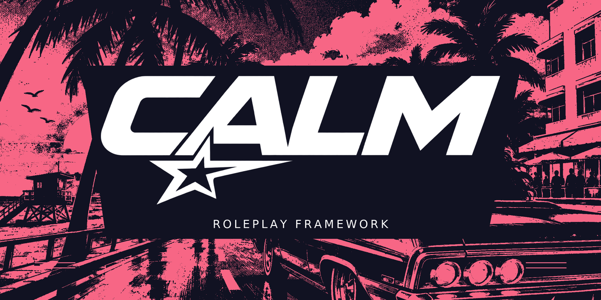

<div align="center">



# CALM — GTA VI Roleplay Project

**CALM Essentials** — an original, open-source **GTA VI-first roleplay project**.

CALM is being designed specifically for roleplay around GTA VI's publicly observable mechanics. It is not a generic framework, an ESX/QBCore/Qbox port, or a GTA V/FiveM architecture. The released GTA VI product is currently a single-player experience on PlayStation 5 and Xbox Series X|S; no authorized GTA VI multiplayer runtime or PC interface is implemented here. CALM's simulator is a way to verify CALM-owned RP rules, not a game emulator or compatibility claim. The repository is unaffiliated with Rockstar Games; brand and trademark clearance remain pending.

[](https://github.com/smouj/calm-rp-framework/actions/workflows/ci.yml)
[](./LICENSE)
[](./docs/roadmap/ROADMAP.md)
[](./CONTRIBUTING.md)
[](https://discord.com/invite/BVWXWY5eUT)
[](./docs/server/RUNTIME_REQUIREMENTS.md)

**[English](./README.md) · [Español](./README.es.md) · [Contributing](./CONTRIBUTING.md) · [Code of Conduct](./CODE_OF_CONDUCT.md) · [Support](./SUPPORT.md) · [Roadmap](./docs/roadmap/ROADMAP.md) · [Goals](./GOALS.md) · [Discord community](https://discord.com/invite/BVWXWY5eUT)**

</div>

> [!IMPORTANT]
> **Not playable or connected to GTA VI.** There is no GTA VI multiplayer client, custom server, installer or mod download here. This project develops CALM's own GTA VI-targeted RP systems. Actual game integration is blocked until a documented and authorized GTA VI runtime exists. CALM is not FiveM for GTA VI or an official Rockstar product.

## Our vision

Build **CALM Essentials** for a future GTA VI roleplay path: systems shaped around the game's observed mechanics and CALM's intended community, including character identity, economy, carried items and vehicle/property storage. The simulator checks CALM's rules before a game runtime is available. Contributors improve these target-specific systems, security and research; they do not create a generic framework for other games or copy GTA V frameworks.

CALM does not use ESX/QBCore/Qbox or FiveM as its product blueprint or compatibility target. Public GTA VI gameplay and developer statements can inform original CALM roleplay requirements; they do not reveal authorized multiplayer APIs or the game's proprietary internals. Developers, artists, testers, documentation writers, security specialists and fans are welcome. No GTA VI game files, leaked artifacts, native names, addresses or internal signatures are used as CALM contracts.

- [ADR-0009 — GTA VI-first product scope and evidence limits](./docs/adr/0009-gta-vi-first-product-scope.md)
- [Verified audit of the current code: present vs. missing](./docs/PROJECT_SCOPE.md)
- [CALM's original service-contract proposal](./docs/architecture/CALM_ESSENTIALS_SERVICE_CONTRACTS_PROPOSAL.md)
- [ADR-0010 — owner-namespaced feature modules (`smj_*`)](./docs/adr/0010-user-owned-feature-modules.md)
- [Character progression design boundary](./docs/server/CHARACTER_PROGRESSION.md)

## CALM product evidence and integration boundary

This repository contains CALM's own RP requirements, simulator and product-focused evidence from official statements and publicly described gameplay. Its runtime-readiness contracts fail closed; they do not invent GTA VI commands. Research on unofficial PC execution projects, reverse-engineering tools and external framework internals is maintained separately as documentation and does not define CALM's architecture, dependencies or APIs.

- [GTA VI RP mechanics observed by the press and our design consequences](./docs/research/GTA6_RP_MECHANICS_2026-11-25.md)
- [GTA VI campaign systems and public implementation observations](./docs/research/GTA6_INTERNAL_SYSTEMS_2026-11-27.md)
- [Current GTA VI platform and runtime status](./docs/research/PLATFORM_STATUS.md)
- [CALM first-party evidence register](./docs/research/FIRST_PARTY_EVIDENCE_2026-11-24.md)
- [Spain/EU interoperability and intellectual-property review](./docs/legal/INTEROPERABILITY_AND_IP_REVIEW_2026-11-24.md)
- [EU and Spanish provisions relevant to interoperability and copyright](./docs/legal/LEGAL_BASIS_ARTICLES_2026-11-24.md) — research references, not a legal opinion.
- [Local verification: the authoritative gate, independent of hosted CI](./docs/operations/LOCAL_VERIFICATION.md)

CALM's technical scope is its RP framework. External compatibility studies are documentary context only; they do not establish a supported game interface or permission to run a multiplayer service.

## Project status

F2 now includes a PostgreSQL inventory repository and authenticated service for CALM's GTA VI RP carried-item and storage rules. The deterministic simulator exercises carry, vehicle storage, retrieval and transfer using synthetic data. Embedded restart and rollback coverage is local; the live PostgreSQL 17 concurrency suite remains a required hosted-CI gate. None of this connects to GTA VI or reads game files. See the [inventory reference](./docs/server/INVENTORY_REFERENCE.md), [F2 design decision](./docs/adr/0008-persistent-inventory-containers.md) and [first-party evidence register](./docs/research/FIRST_PARTY_EVIDENCE_2026-11-24.md).

| Area                                                      | Actual state                                                                                                                                                                                                                                                         |
| --------------------------------------------------------- | -------------------------------------------------------------------------------------------------------------------------------------------------------------------------------------------------------------------------------------------------------------------- |
| Persistent characters, sessions and economy (F1)          | PostgreSQL identity/session/ledger services plus a loopback-only HTTP API, server-resolved operator grants and append-only audit; no public player identity provider or GTA VI runtime adapter. See the [API operation guide](./docs/operations/API_F1_LOCAL.es.md). |
| Characters, economy and inventory rules (in-memory)       | Reference implementations with tests                                                                                                                                                                                                                                 |
| GTA VI RP inventory persistence                           | CALM-owned schema, authenticated transactional service/repository, immutable movement receipts, capacity checks and embedded restart tests; live PostgreSQL 17 race suite is a CI gate                                                                               |
| GTA VI-targeted RP simulator                              | Deterministic two-character prototype, including synthetic carry/storage/retrieval/trade flow; validates CALM rules only                                                                                                                                             |
| Persistence infrastructure                                | `packages/persistence`: migration runner, `pg` pool, embedded-PostgreSQL verification engine                                                                                                                                                                         |
| Security, research and automated checks                   | Foundation                                                                                                                                                                                                                                                           |
| Cfx/FiveM ecosystem                                       | Not a CALM implementation target                                                                                                                                                                                                                                     |
| GTA VI game/runtime adapter                               | **BLOCKED** — authorization and runtime contracts unknown                                                                                                                                                                                                            |
| GTA VI client, multiplayer server or downloadable release | **NOT IMPLEMENTED**                                                                                                                                                                                                                                                  |

Rockstar announced the game's console launch on **19 November 2026**; that does **not** establish community-server support. See the [official release announcement](https://www.rockstargames.com/newswire/article/39akk424a9oo53/grand-theft-auto-vi-now-available).

**Hosted CI is the merge gate.** It runs the full checks and live PostgreSQL 17 suite on each pull request. A locally skipped live suite is not evidence that the database gate passed; check the [current CI runs](https://github.com/smouj/calm-rp-framework/actions/workflows/ci.yml) for the exact candidate commit.

See the [roadmap](./docs/roadmap/ROADMAP.md), [platform status](./docs/research/PLATFORM_STATUS.md) and [runtime requirements](./docs/server/RUNTIME_REQUIREMENTS.md). We never mark a proposed feature as implemented.

## How it is designed

```text
                 COMMUNITY CONTRIBUTORS
                          |
             documentation + pull requests
                          |
               GTA VI-FIRST RP DOMAINS
            characters / economy / inventory
           property / permissions / contracts
                       /       \
                      /         \
              SIMULATOR       RUNTIME ADAPTER
          test without GTA VI   (future, blocked)
                                     |
                            GTA VI authorization
                            & APIs NOT CONFIRMED
```

CALM's domain rules are server-authoritative: a future client would request actions and CALM's validated server commands would decide outcomes. The simulator exercises those rules now. Unknown game APIs, client-native functions, asset formats and networking protocols stay outside the implementation until authorized documentation exists. PC execution projects and third-party GTA VI research are **not** evidence of a working RP integration.

## GTA VI-inspired synthetic world planning

The simulator now includes an original, in-memory [world-planning catalog](./docs/server/WORLD_SPATIAL_READINESS.md): CALM-owned location IDs, coordinate spaces, interior/exterior classifications, bounded 3D geometry, parent hierarchies and deterministic proximity queries for the target RP design. **No GTA VI map/asset data, navigation API, world hook, multiplayer interface or proprietary coordinates are involved.** The [proposed ADR-0005](./docs/adr/0005-independent-world-planning.md) documents its limitations.

## Repository structure

- [`packages/core`](./packages/core/src/index.ts): CALM-owned rules for the GTA VI RP target.
- [`packages/contracts`](./packages/contracts/src/index.ts): typed commands and events.
- [`adapters/simulator`](./adapters/simulator/src/index.ts): deterministic tests without any game.
- [`adapters/cfx`](./adapters/cfx/README.md): current ecosystem research only.
- [`adapters/gta6`](./adapters/gta6/README.md): future integration boundary; currently reserved.
- [`apps/api`](./apps/api/src/index.ts): application/transport scaffold.
- [`infrastructure`](./infrastructure): local development services.
- [`docs`](./docs/README.md): architecture, research, security, roadmap and decisions.

## Run the development checks

You do **not** need GTA VI or any game files.

**Prerequisites:** Node.js 22+, pnpm 10.34.5 and, optionally, Docker for the local database.

```bash
git clone https://github.com/smouj/calm-rp-framework.git
cd calm-rp-framework
corepack enable
corepack prepare pnpm@10.34.5 --activate
pnpm install --frozen-lockfile
pnpm check
```

Optional development infrastructure:

Copy `.env.example` to `.env`, set a unique 64-character random hexadecimal `POSTGRES_PASSWORD`, and do not reuse it in production. `.env` is ignored by Git.

```bash
docker compose -f infrastructure/docker/compose.yml up -d
```

`pnpm check` runs linting, TypeScript checks, unit tests and formatting validation. It does **not** run GTA VI or start a roleplay server.

## Website and CALM's working name

The static information website lives in [`site/`](./site/README.md), including a [self-contained legal notice](./site/legal.html). GitHub Pages is enabled; verify the current deployment before treating its URL as a release artifact. **CALM** is the project's chosen working name (a deliberate contrast in tone with RAGE) and **CALM Essentials** is the product name; neither is a cleared or exclusive trademark. FINOS already uses CALM for a software architecture specification, and Calm.com uses CALM for software products. See the [brand decision and conflict notes](./docs/branding/FRAMEWORK_NAMING_OPTIONS.md). No API or package namespace was renamed.

## Get involved

- Read [CONTRIBUTING.md](./CONTRIBUTING.md) ([español](./CONTRIBUTING.es.md)), [CODE_OF_CONDUCT.md](./CODE_OF_CONDUCT.md) and [GOVERNANCE.md](./GOVERNANCE.md).
- Browse [issues](https://github.com/smouj/calm-rp-framework/issues), including [good first issues](https://github.com/smouj/calm-rp-framework/labels/good%20first%20issue) and [help wanted](https://github.com/smouj/calm-rp-framework/labels/help%20wanted).
- Propose one scoped change, create a fork and open a [pull request](https://github.com/smouj/calm-rp-framework/pulls).
- Prefer reproducible tests, safe mock data and documentation with public sources. No secrets, leaks or proprietary game files.

Contributions are welcome; merging requires review and passing checks. Check the [FAQ](./docs/community/FAQ.md) and [SUPPORT.md](./SUPPORT.md) for help and [SECURITY.md](./SECURITY.md) for private vulnerability reports.

## Roadmap

0. **GTA VI-first product definition** — ✅ clarified 2026-11-27 in ADR-0009; no generic-game or GTA V framework target.
1. **Persistence and characters** — PostgreSQL-backed accounts, characters and sessions that survive restarts; balanced-ledger invariant; unified identifiers.
2. **Economy and inventory** — durable, idempotent transactions; containers (vehicle, warehouse, property) with location-independent ownership.
3. **Jobs and organizations** — grades, duty, salaries and a full payroll cycle linked to financial accounts.
4. **CALM domain composition** — add internal module boundaries only when GTA VI RP workflows need them; no third-party resource ABI is promised.
5. **Game adaptation** — **blocked** until a public, authorized GTA VI integration path exists.

First tangible goal: a simulated GTA VI RP slice where two characters work, get paid, buy, carry, store and trade items, and retain state after a restart. This verifies CALM behavior, not GTA VI compatibility.

[Full roadmap](./docs/roadmap/ROADMAP.md) · [Architecture](./ARCHITECTURE.md) · [Scope](./docs/PROJECT_SCOPE.md) · [Research protocol](./docs/research/RESEARCH_PROTOCOL.md)

## Intellectual property and non-affiliation

**Unofficial fan project. Not affiliated with, endorsed by or sponsored by Rockstar Games, Take-Two Interactive or Cfx.re.** Grand Theft Auto, GTA, Grand Theft Auto VI, game logos, names, artwork, characters, audio and other protected game content belong to their respective rights holders, including Rockstar Games and Take-Two Interactive. All rights to that content are reserved by its owners.

The [MIT license](./LICENSE) covers **only the original source code and documentation** contributed to this repository. It does not license Rockstar's games, assets or trademarks. No game binaries, keys, extracted assets or leaked material are included. We do not claim authorization to host or connect to GTA VI multiplayer servers.

Read [TRADEMARKS.md](./TRADEMARKS.md), the [Rockstar RP policy](https://support.rockstargames.com/articles/5I66kExWgligszgMCU3XC1/roleplay-rp-servers), [mod guidelines](https://www.rockstargames.com/es/community-resources/mod-guidelines) and [Creator Platform terms](https://fivem.net/terms/). Attribution and disclaimers **do not constitute permission** from the rights holders.
