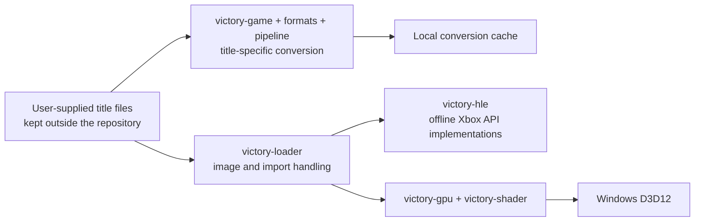

# VIctory source audit and CALM relevance

**Reviewed:** 2026-11-26 · **Snapshot:** `Marvisak/VIctory` commit `63bcca43c6a00a758510398fa43096ce7e4f7df0` · **Method:** static review of the public source and documentation, plus a local Defender scan of the source checkout.

## Finding

VIctory is an Xbox-to-Windows execution and compatibility layer. It is **not** the source code of Grand Theft Auto VI, an RP framework, or a community multiplayer server runtime. Its README says it runs the Xbox title executable supplied by the user; its networking is deliberately offline. The reviewed source exposes no GTA VI roleplay or multiplayer interface.

The status and performance figures below are the project's own report, not results reproduced by CALM. No build, test, local game executable, game package, or torrent payload was acquired or run. The submitted executable hash was compared with public report metadata; no local file was hashed, and that comparison does not inspect the torrent bundle.

## What the repository contains

The upstream README describes the title's x86-64 executable running in a Windows process while VIctory supplies console and graphics APIs. The main pieces are:

| Area                    | Repository components                   | Role                                                                                                                                                                      |
| ----------------------- | --------------------------------------- | ------------------------------------------------------------------------------------------------------------------------------------------------------------------------- |
| Process loading         | `victory-pe`, `victory-loader`          | Parse/map a PE image and resolve imports to VIctory, approved Windows APIs, title DLLs, or explicit missing-import stubs.                                                 |
| Console services        | `victory-hle`                           | Emulate imported Xbox APIs, including user, save, storage, package, UI, and networking services.                                                                          |
| Title-specific handling | `victory-game`                          | Identify supported builds and hold game-specific container, shader-pack, and hook logic. This is compatibility code around an executable, not Rockstar's original source. |
| Data conversion         | `victory-formats`, `victory-pipeline`   | Read supported texture/audio formats and cache converted data outside the checkout.                                                                                       |
| Graphics                | `victory-gpu`, `victory-shader`         | Translate console graphics/shader operations to Windows D3D12 and host shaders.                                                                                           |
| CLI and policy          | `apps/victory`, `victory-core`, `xtask` | Configure/run the compatibility layer and enforce the repository's asset policy.                                                                                          |

## Network and multiplayer boundary

The source makes the offline boundary explicit:

- `xnetworking` reports initialized but unavailable connectivity; service-provided security information cannot be retrieved, certificates do not pass, and connectivity callbacks do not fire.
- The Winsock/WinHTTP shim in `net.rs` allows loopback only, blocks external connections and lookups, and narrows or rejects non-loopback binds.
- The README labels networking “offline by design.”

That is useful evidence about VIctory's scope. It does not provide player synchronization, sessions for multiple game clients, authoritative world state, server-side gameplay, or a resource scripting API. Adding networking to this compatibility layer would be a separate project and would still not establish authorization or a supported GTA VI contract.

## Provenance, license, and local checkout

- The repository's workspace license is GPL-3.0-or-later. CALM is MIT, so no VIctory implementation was copied into CALM.
- VIctory's `docs/asset-policy.md` says game files and derived assets must remain outside the repository and describes a single 77,982-byte `bcpack-tables.bin` exception as format data not covered by the repository license. Its contents were not inspected or reused.
- The checkout on `D:\VIctory` contains source, docs, tests, and that documented exception; a static file-name scan found no game executable, title DLL, archive, or installer. Git status is clean at the reviewed commit.
- The README reports about 1 FPS in the world on one tested Windows 11/RX 6700 XT machine as of 2026-11-25. CALM did not reproduce that report.

## Security review of the source checkout

- Microsoft Defender's custom scan of `D:\VIctory` completed on 2026-11-26. No Defender detection record referenced that path.
- Targeted static searches of production Rust sources, manifests, build scripts, and workflow did not identify an obvious downloader, credential collector, startup persistence mechanism, or external HTTP client dependency. The production subprocess paths found are documented: a `rustc -vV` build probe, Git maintenance, relaunching the current VIctory executable, and optional audio-capture diagnostics. The game networking shim is explicitly loopback-only.
- These checks reduce suspicion for this source checkout; they cannot prove absence of unknown defects or make a separately compiled binary safe. The repository was not built or executed, and its Rust dependencies were not fetched for a supply-chain scan.
- The torrent package remains unscanned because it was not downloaded. Triage has multiple reports for the submitted executable SHA-256 with conflicting results: the 2026-11-23 report shows zero signatures in four 150-second runs; a 2026-11-24 report shows zero signatures in one 900-second Windows 10 run but 14 signatures, an 8/10 score, and adware/persistence/ransomware/spyware labels in a 900-second Windows 11 run. The latter's displayed events are attributed mainly to Windows shell processes (such as `explorer.exe` and `SearchHost.exe`), so the report alone does not establish that those actions came from the game executable. It still prevents calling the sample clean without a reliable explanation. That Windows 11 run reports zero network requests. [First Triage report](https://tria.ge/261123-r8pajade52) · [Second Triage report](https://tria.ge/261124-qqkzqahs4t/behavioral2).
- Triage also shows a 56.9 MB password-protected ZIP (SHA-256 `5390e495d9d4ce3695aefcd8f6de467a85717b7adabd7fb03196c732b0cb29cc`) containing an executable with the submitted EXE hash. This is a different archive digest from the posted ZIP SHA-256 `7545a2f7fb4b399cf8850987f087ed9a4d8499ddb6d6c2d642fd60c27f569730`; it does not validate that ZIP. Triage's `Unsigned PE` label only states that the executable has no Authenticode signature; it is not, by itself, a malware verdict. [Triage archive report](https://tria.ge/261123-3mrpbags71/static1).

## Torrent lead

A user-supplied short URL resolves to RuTracker topic `6943348`. Read-only access to the forum page returned HTTP 403, so the post's file list, author, executable, and any SHA-256 value could not be verified. No torrent, magnet, payload, or executable was downloaded, and no local file was hashed.

A SHA-256 value can compare a file with an expected digest, but it does not establish who produced the file or whether it is safe. A digest posted alongside the same untrusted torrent has no independent trust anchor. The quoted executable hash matches public Triage metadata, but the Triage outcomes conflict and cannot certify it as safe. The posted ZIP digest was not verified against a trusted publisher source. Neither value authenticates a recomp, launcher, installer, DLL, or other file in the torrent. Treat the package as unverified and do not use it as project input.

For context only, Take-Two's public GitHub DMCA notice concerns a **different** GTA VI recompilation repository and alleges that it depended on stolen Xbox-build files; the filing requests action on a network of 3,007 repositories. That notice does not establish what is inside the RuTracker topic or make a legal finding about VIctory. It does show why “all files included” is not acceptable provenance for CALM research. [Read the filing](https://github.com/github/dmca/blob/master/2026/11/2026-11-24-take-two.md).

## GameDrive link supplied for review

The page advertises a leaked Xbox 1.0.2.1 executable, says it is currently unplayable and tells visitors not to download unless they know what they are doing. It prints the same EXE hash discussed above and points to `filevault.cybar.to`; it does not provide the ZIP hash. A copied hash on a download page does not authenticate the bytes behind its link.

Reputation checks raise substantial caution. Gridinsoft's directly retrieved 2026-10-31 report rates `gamedrive.org` 17/100 with 5 of 29 provider warnings; its indexed 2026-11-19 summary reports 10/100 with 6 of 30, so the score is not stable across snapshots. Its `filevault.cybar.to` report from 2026-11-23 rates that host 1/100 with 3 of 25 warnings (G-Data, Webroot and Bitdefender). PCrisk's 2026-10-28 automated scan flags the domain through 6 of 93 engines and reports generic signatures across multiple site resources, including a separate Cyberleek-related page; these are domain/resource signals, not a malware verdict for this specific EXE. [GameDrive reputation report](https://gridinsoft.com/online-virus-scanner/url/gamedrive-org) · [File host reputation report](https://gridinsoft.com/online-virus-scanner/url/filevault-cybar-to) · [PCrisk scan details](https://scanner.pcrisk.com/scan-results/gamedrive.org).

The download link was not opened. No archive or executable was downloaded, submitted to a scanner, or hashed locally. Treat both the page and its file host as high risk; the page's text and a valid-looking HTTPS connection are not safety checks.

## New leak developments checked on 2026-11-26

The public timeline has moved on from the earlier “build without its executable” claim. PC Gamer reported on 19 November that Cyberleek claimed to have released an approximately 200 GB Xbox build while withholding the main executable. On 23 November, it reported that the executable appeared to have been released, but its reporter explicitly said the file's authenticity had not been verified. These reports establish that the claim changed, not that the bytes are genuine or safe. [19-November report](https://www.pcgamer.com/games/grand-theft-auto/cyberleek-drops-what-they-claim-is-a-near-complete-gta-6-xbox-build-online/) · [23-November update](https://www.pcgamer.com/games/grand-theft-auto/cyberleek-releases-executable-for-gta-6-xbox-build-leaked-last-week-the-torch-passes-to-the-open-source-recomp-and-emulation-projects/).

Take-Two's 24-November GitHub DMCA notice alleges that stolen Xbox Series build files were publicly distributed on 20 November and that the Leonida recompilation repository opened the next day with those files as its required input. Take-Two requested takedown of the repository and its 2,900+ forks; GitHub's notice says it processed the notice against 3,007 repositories. This is a rights-holder allegation and a platform takedown, not a court judgment or proof that each fork contained identical material. It is nevertheless strong evidence that leak-dependent recompilation projects carry substantial legal and continuity risk. The notice does not establish any supported RP, multiplayer, scripting or server interface. [GitHub's published DMCA notice](https://github.com/github/dmca/blob/master/2026/11/2026-11-24-take-two.md).

The local `D:\VIctory` checkout remains at commit `63bcca43c6a00a758510398fa43096ce7e4f7df0`, matching the public `main` ref checked read-only on 26 November. Its 25-November README claims that the title boots through the prologue on one Windows 11/RX 6700 XT machine, but runs at about one frame per second in the world and is not playable; it also describes possible GPU faults. Those are project-reported compatibility results, not independent reproduction and not evidence of an RP server. [VIctory status report](https://maketecheasier.com/cyberleek-gta-6-xbox-executable-released/).

Security reporting adds a separate and concrete warning about copycat downloads. Netcraft counted 121 newly registered domains containing “cyberleek” in its July–October review; it says the set includes legitimate and non-fraudulent domains as well as scam lures. One fake `GTAVI.exe` sample was flagged by 34 of 68 VirusTotal engines, and a separate fake launcher by 18 of 62. ESET also lists the deceptive filename `CyberLeek-GTAVI-GTA6-PreBuild.torrent.exe`: despite “torrent” in its name, it is an executable lure. Cynet's lab analysis of a _different_ fake free-download sample identified a WARDEN Stealer loader that targeted credentials and browser data and told victims to run as administrator or disable protections. These samples are not the user-supplied `game_scarlett_master.exe` and do not prove that it has the same payload. [Netcraft research](https://www.netcraft.com/blog/how-attackers-are-capitalizing-on-the-hype-around-the-grand-theft-auto-vi-release) · [ESET's Spanish analysis](https://www.welivesecurity.com/es/estafas-enganos/gta-6-estafas-descargas-maliciosas/) · [Cynet sample analysis](https://www.cynet.com/blog/download-gta6-for-free-inside-the-malware-trap/).

In response, CALM's repository path guard now blocks `.apk` and common Windows installer packages in addition to `.exe`, torrent, console-package and game-export formats. That is an accidental-staging barrier; it does not inspect contents or certify files as malware-free.

The official 19-November launch announcement names PlayStation 5 and Xbox Series X|S. None of the newly reviewed public evidence establishes an authorized PC runtime or a community-server contract. **Inference for CALM:** this leak does not change any `RT-*` status or justify importing leaked assets, binaries, offsets, extracted data or code. Keep the framework's domain and simulator work independent, and treat any request to disable antivirus, run an alleged game file as administrator, or add a security exclusion as a stop signal. [Take-Two/Rockstar launch announcement](https://taketwointeractivesoftwareinc.gcs-web.com/node/32696/pdf).

## Repository-discovery mirror supplied for review

`git.gtahub.st` identifies itself as a read-only Forgejo copy of GitHub repositories, says it syncs every five minutes, and offers account registration. Its `Marvisak--VIctory` entry lists 692 commits and latest commit `63bcca43`; that short hash matches both the local `D:\VIctory` checkout and GitHub's `main` ref when checked read-only. Searches for `roleplay` and `server` returned no matching repository metadata on that instance. This is useful as a discovery index, not a trusted code origin; no account was created and no archive or repository was downloaded from it. [Third-party mirror index](https://git.gtahub.st/explore/repos) · [Canonical VIctory repository](https://github.com/Marvisak/VIctory).

## Consequence for CALM

This review does not change any runtime requirement or unblock roadmap phase F5. VIctory can inform a narrow discussion of how compatibility software separates host services, title-specific adapters, and generated caches. Its executable mapping, console API emulation, game formats, hooks, and graphics translation do not define roleplay systems or a GTA VI server contract.

CALM should continue building its own domain services and simulator. The next framework work remains persistent inventory and containers, with ownership separate from physical location and idempotent concurrent transfers, under phase F2. Any GTA VI adapter remains gated on a documented and authorized runtime.

## Pinned primary references

- [VIctory source snapshot](https://github.com/Marvisak/VIctory/tree/63bcca43c6a00a758510398fa43096ce7e4f7df0)
- [VIctory README](https://github.com/Marvisak/VIctory/blob/63bcca43c6a00a758510398fa43096ce7e4f7df0/README.md)
- [VIctory architecture](https://github.com/Marvisak/VIctory/blob/63bcca43c6a00a758510398fa43096ce7e4f7df0/docs/architecture.md)
- [VIctory asset policy](https://github.com/Marvisak/VIctory/blob/63bcca43c6a00a758510398fa43096ce7e4f7df0/docs/asset-policy.md)
- [Offline network shim](https://github.com/Marvisak/VIctory/blob/63bcca43c6a00a758510398fa43096ce7e4f7df0/crates/victory-hle/src/modules/net.rs)
- [Offline Xbox networking API](https://github.com/Marvisak/VIctory/blob/63bcca43c6a00a758510398fa43096ce7e4f7df0/crates/victory-hle/src/modules/xnetworking.rs)
